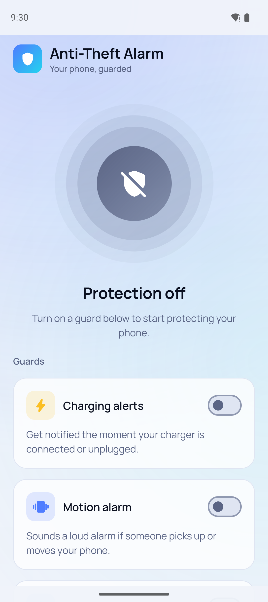
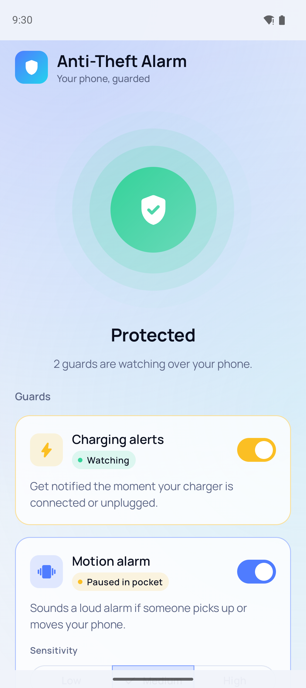
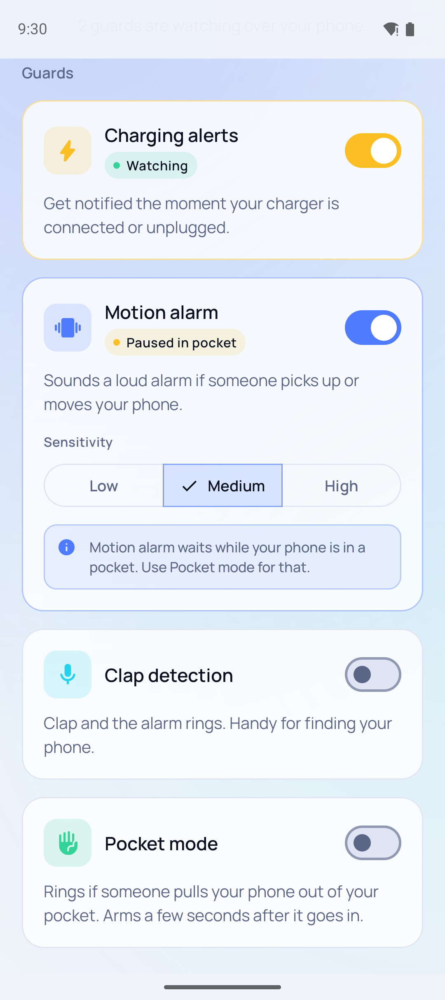
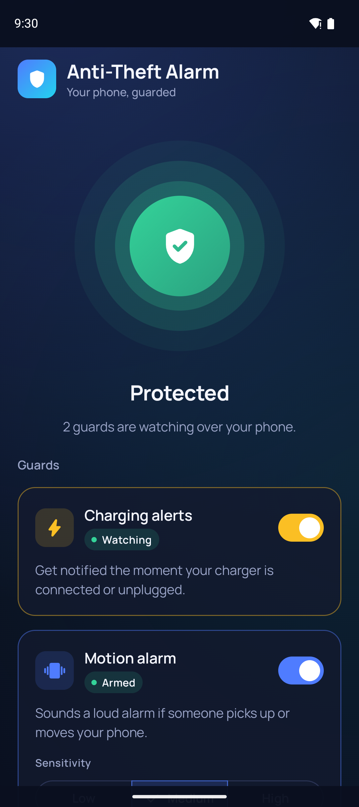
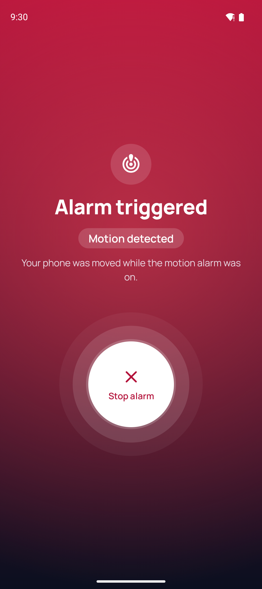

# Anti-Theft Alarm

An Android app that guards your phone in the background. It warns you when the charger is
pulled, and it sounds a loud siren if someone picks up the phone, takes it out of your pocket,
or if you clap to find it.

Built with Kotlin, Jetpack Compose (Material 3), Clean Architecture, Koin and Navigation 3.

## Screenshots

| Protection off | Protected | Guards |
|---|---|---|
|  |  |  |

| Dark theme | Alarm triggered |
|---|---|
|  |  |

## Features

- **Charging alerts.** Sends a "Charger connected" or "Charger disconnected" notification the
  moment the cable goes in or comes out.
- **Motion alarm.** Arms once the phone has been still for 5 seconds. If someone then picks it
  up or moves it, a looping siren plays at full alarm volume, with vibration. You can stop it
  from the app or from the notification. It keeps working with the screen off.
- **Pocket mode.** Arms a few seconds after the phone goes into a pocket, using the proximity
  and light sensors. It rings if someone pulls the phone out. A phone lying face-down on a
  desk doesn't count as being in a pocket.
- **Clap detection.** Listens through the microphone and rings when you clap, which helps you
  find the phone. It checks how sharp, bright and short the sound is, so speech, music and
  thuds don't set it off.
- **Sensitivity.** Motion and clap detection each have Low, Medium and High settings.
- **Live status.** Each guard shows its state: Watching, Arming, Armed, Listening, or Paused
  in pocket.
- **Permissions.** Notification and microphone permissions are requested only when a guard
  needs them. If you deny a permission permanently, the app sends you to Settings and turns
  the guard on when you come back.
- **Reliable in the background.** Protection runs in a foreground service that is built to
  avoid crashes and ANRs and to recover after the process is killed.
- **Adaptive UI.** Light and dark themes, edge-to-edge layout, portrait and landscape (two
  panes on wide screens), and support for large fonts.

## Tech stack

| | |
|---|---|
| Language | Kotlin 2.2 |
| UI | Jetpack Compose, Material 3, bundled Manrope font |
| Architecture | Clean Architecture (domain / data / presentation), MVVM with UiState / Event / Effect |
| DI | Koin 4.2 |
| Navigation | Navigation 3 |
| Persistence | DataStore Preferences |
| Async | Kotlin Coroutines & Flow |
| Testing | JUnit, kotlinx-coroutines-test |
| Build | AGP 9.4 with built-in Kotlin, version catalog |

Min SDK 24, target/compile SDK 37.

## Architecture

```
app/src/main/java/com/anti/theft/
├── di/              Koin modules
├── domain/
│   ├── models/      settings, permission, capability, protection status
│   ├── repo/        repository interfaces
│   ├── usecase/     ToggleFeature, ResolvePermissionStatus, SyncProtection
│   └── detector/    MotionDetector, ClapDetector, pocket logic (pure Kotlin, unit-tested)
├── data/
│   ├── local/       DataStore, in-memory protection state
│   ├── repo/        repository implementations
│   └── service/     ProtectionService (foreground) + sensor, microphone, alarm, notifications
├── presentation/
│   ├── home/        Home screen, ViewModel, components
│   └── alarm/       Alarm screen, ViewModel, components
└── core/            navigation, theme, shared UI, utils, dispatchers
```

The UI never talks to the service directly. `SyncProtectionUseCase` works out which guards
can run (switch on, permission granted, sensor present) and starts, updates or stops
`ProtectionService`. The service publishes live state, which the ViewModels observe.

## Permissions

| Permission | Why |
|---|---|
| `POST_NOTIFICATIONS` | Charging alerts and the alarm's Stop action |
| `RECORD_AUDIO` | Clap detection (only when it is turned on) |
| `FOREGROUND_SERVICE`, `_SPECIAL_USE`, `_MICROPHONE` | Keep protection running in the background |
| `WAKE_LOCK` | Keep the accelerometer running with the screen off |
| `VIBRATE` | Vibrate while the alarm rings |

The app has no network access and collects no data.

## Build and run

```bash
./gradlew assembleDebug        # build the debug APK
./gradlew installDebug         # install on a connected device or emulator
./gradlew testDebugUnitTest    # run unit tests
./gradlew lintDebug            # run Android lint
```

You don't need any API keys. Open the project in a recent Android Studio that supports
AGP 9.4.

## Tips

Some manufacturers (Xiaomi/MIUI, Oppo, Vivo and others) kill background apps aggressively.
For protection to survive, turn on **Autostart** and set battery usage to **No restrictions**
for the app. The app shows a tip that links to these settings.
